Competency Dimensions (local_dimensions)
========================================

See your learning path in a new dimension.

Moodle's competency frameworks and learning plans, managed from one hub and shown to learners as
something they can read at a glance. The plugin creates no database tables: everything it shows
and edits lives in Moodle's own competency data.

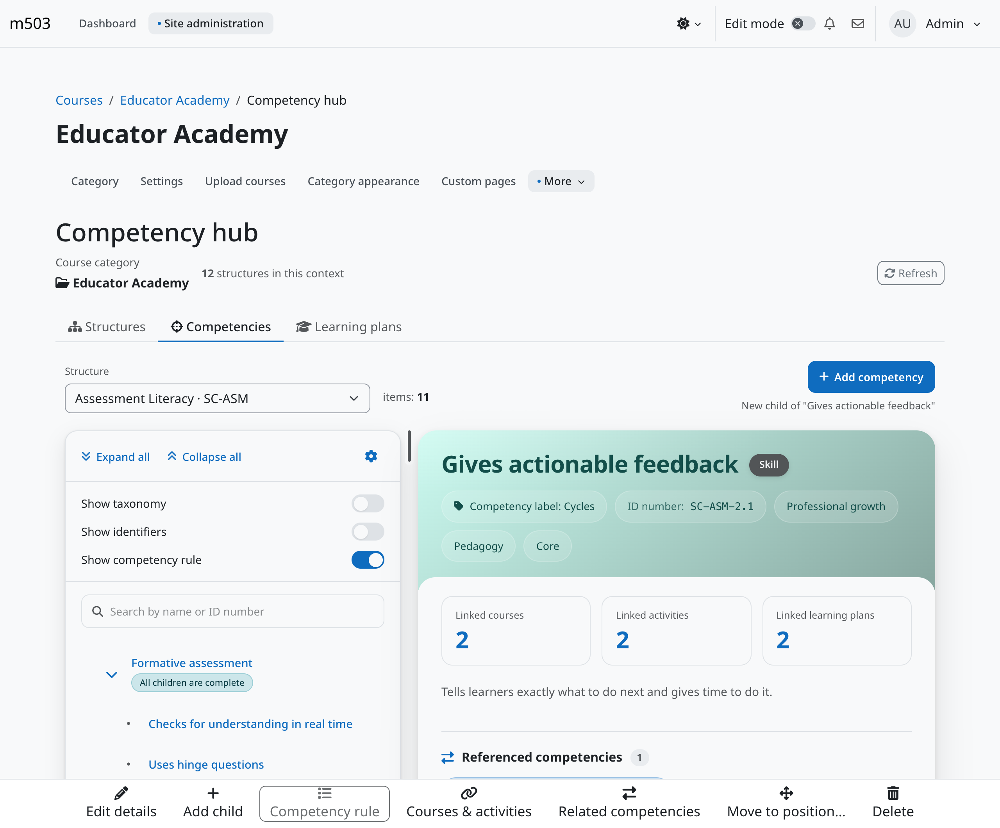

Moodle's competency system can express a great deal: frameworks with scales and completion rules,
competencies linked to courses and activities, plan templates synchronised with cohorts, reviewers
assigned per cohort. Doing it through core means a dozen admin pages, and learners get a plain list
of competency names. This plugin closes both gaps on top of the same data:

- **The Competency hub** (`central.php`) gathers frameworks, competencies, rules, course and
  activity links, plan templates, participants and cohort roles on one screen, with every edit in
  a modal and no page reload. It opens at the site level or inside a course category, so a
  category manager runs the frameworks and plans of that category alone.
- **Two learner views** turn a plan into something to work through: the *Full plan overview*
  (every competency of the plan, with its courses, activities, rating and evidence) and the
  *Competency tracker* (the courses of one competency as cards with live section progress). Both
  share the fleet's *filter line*: scope, search, favourites, filter chips and the layout, on one
  line that folds down to a phone.
- **A visual identity per plan and per competency**: colours checked for contrast, card and
  background images, tags, a type label and a display mode, all as Moodle custom fields.

Less plugin, more Moodle: the plugin uses what Moodle already stores and already knows how to do,
and avoids depending on non-core plugins wherever a native path exists.

Documentation / Documentação
-----------------------------

Full user and administrator documentation is available online in English and Portuguese:
**[Competency Dimensions Documentation (GitHub Pages)](https://uaiblaine.github.io/moodle-local_dimensions-docs/)**

The Competency hub
------------------

### One hub, two entries

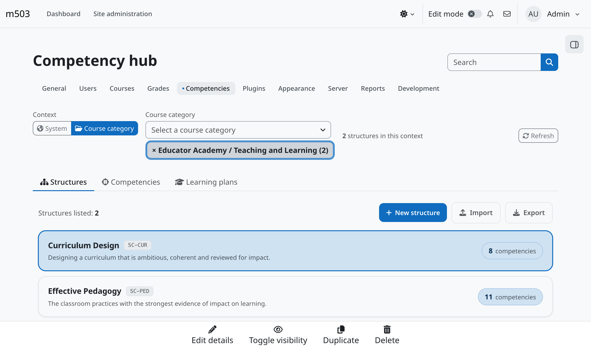

**Site administration > Competencies** opens the hub for anyone holding
`moodle/competency:competencymanage` at the site (site configuration is not required). A
*System / Course category* switch chooses the context, and the hub remembers where you were: tab,
context, selected framework or template and display toggles persist per user, across sessions and
devices.

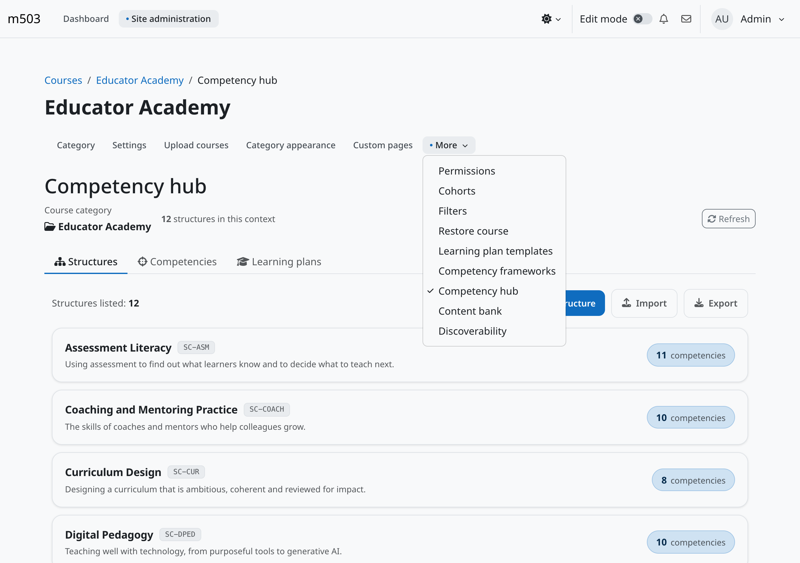

A **course category's More menu**, beside core's *Competency frameworks* and *Learning plan
templates*, opens the hub for a manager holding `competencymanage` or `templatemanage` in that
category only. It is locked to the category: no switch, the category and its subcategories listed
(as core's own category pages do), and nothing from that visit written into the remembered context.

The hub has three tabs: **Structures** (frameworks), **Competencies** and **Learning plans**. The
selected row's actions sit in a bar at the foot of the page.

### Structures

Frameworks are created and edited natively, with scale configuration, duplication, a visibility
toggle, a delete that asks for a reason, and CSV import and export. Each row counts its
competencies.

### Competencies and their rules

The Competencies tab shows one framework as a lazy tree with search-and-reveal and drag-and-drop
to reorder and reparent. *Show competency rule* puts each parent's completion rule beside it as a
chip ("All children are complete", "Points required are met"); *Show taxonomy* and *Show
identifiers* add the rest. Selecting a competency opens its detail: its label, ID number,
tags, how many courses, activities and learning plans use it, its description and its related
competencies.

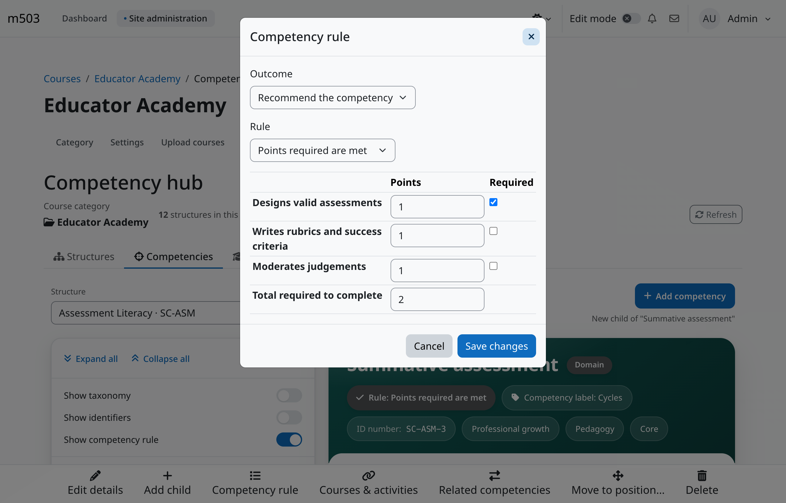

*Competency rule* edits core's completion rule in place: the outcome, then *All children are
complete* or *Points required are met*, with points and a required flag per child and the total
needed.

### Course and activity links

*Courses & activities* links a competency to courses and, inside each course, to activities,
without leaving the hub. Each link carries its outcome on completion (attach evidence, send for
review, complete the competency), and a chip says whether the completion rule that will fire it is
configured, or offers to create it. A course linked without an activity says so.

### Learning plan templates

Templates are managed master-detail: the list (search, *New template*, a filter by competency) and
the selected template drawn in its own colours, with its counters, display format, competency
label, due date, tags and competencies. Templates are created and edited in modals, duplicated in
full (custom fields, embedded files and images included), and given competencies through a picker
with a framework browser. They also travel between sites as **CSV** (competency links and the
plugin's own custom fields included); the import shows a **dry-run preview**, with every row's
projected outcome, its field differences and its effect on existing learner plans, before anything
is written, then applies only what you tick.

### Participants, cohorts and cohort roles

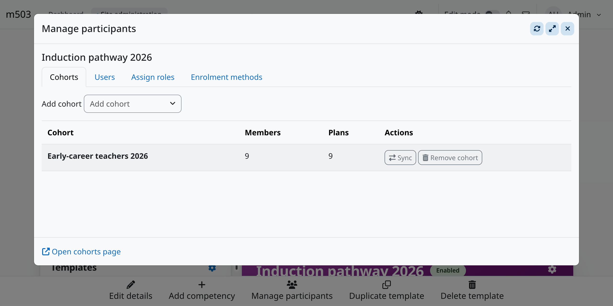

**Manage participants** attaches cohorts to a template; plans for their members are generated in
the background. A *Users* tab adds individual learners.

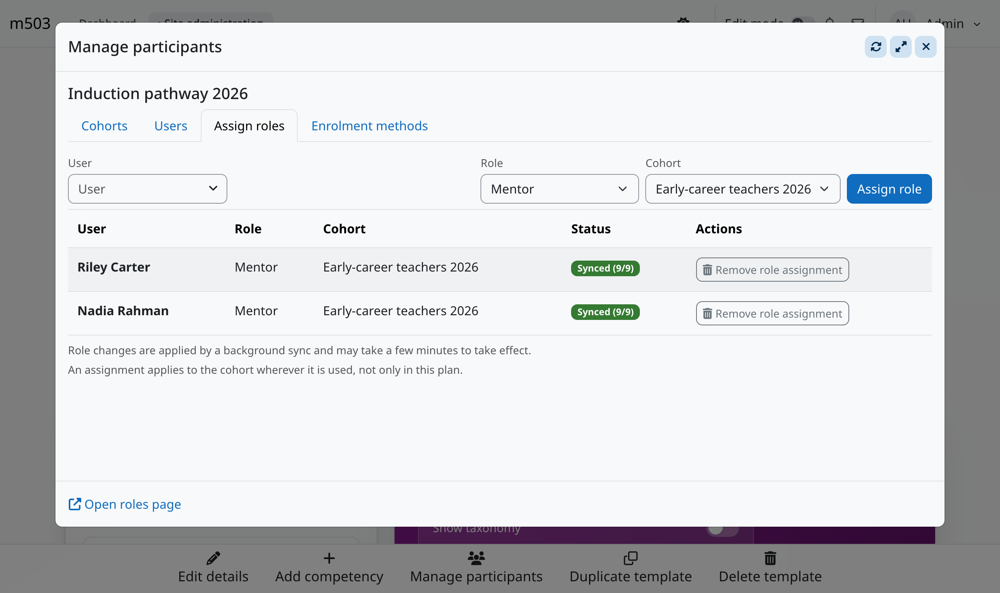

*Assign roles* gives a user a role over every member of a cohort through core's cohort roles
(`tool_cohortroles`, the records its *Assign user roles to cohort* page lists), so mentors and heads
of department can review the plans of the people they look after. The status column shows how far the background sync has gone.

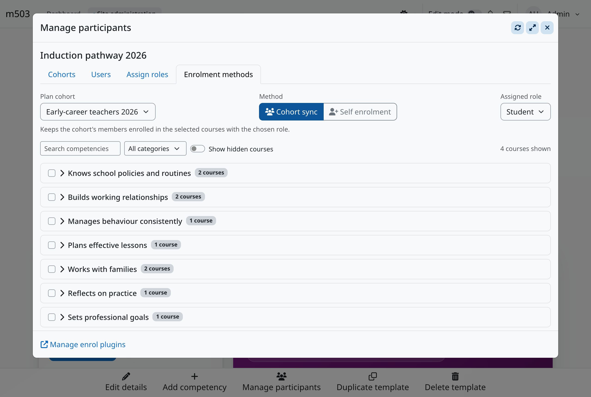

*Enrolment methods* applies or removes **cohort sync** or **cohort-restricted self enrolment**
across all the courses linked to the plan's competencies, as background tasks with a live status
per course.

The hub also logs the administrative decisions core never does (cohort attach and detach, links,
duplication, bulk enrolment actions) as regular Moodle events in the standard log.

### Custom fields: colours, images, tags and display modes

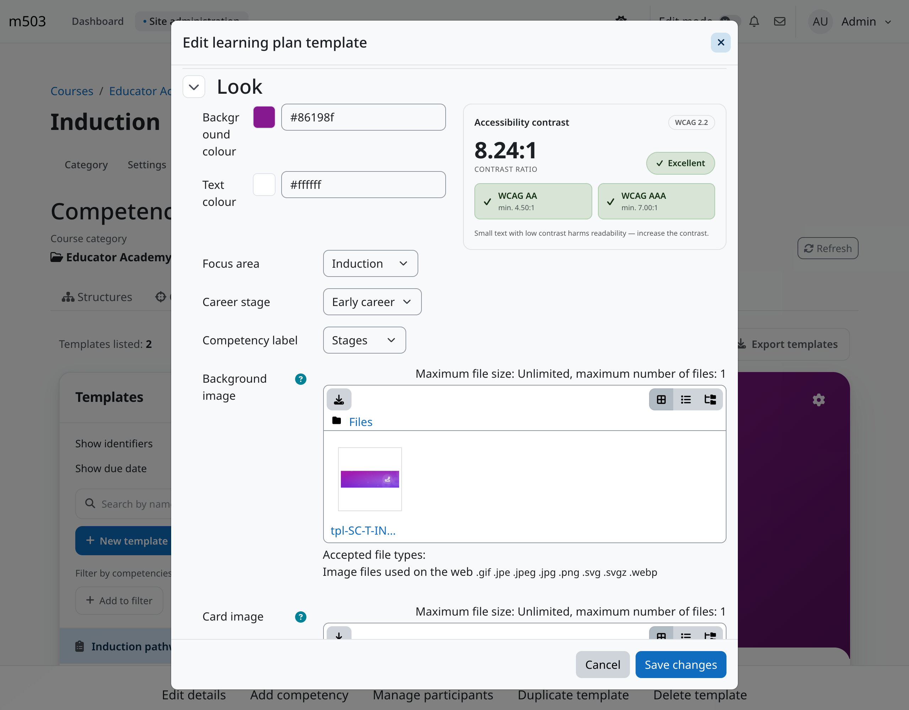

Competencies and templates gain auto-provisioned custom fields:

- **Look**: background and text colours, with a live WCAG 2.2 contrast check; card and hero
  background images (built-in file areas by default, or the external `customfield_picture`
  plugin); two classification tags (here *Focus area* and *Career stage*) and the label a plan
  gives its competencies ("Stages", "Levels"...).
- **Feel**: the per-template **display mode** (*Full plan overview* or *Competency tracker*), the
  accordion subline source, an identifier, and per-plan and per-competency overrides of the
  enrolment filter, the locked-card mode, the single-course redirect and the availability date.
- **Custom SCSS** per template or competency, when enabled: validated and compiled server-side,
  then cached.

Two admin pages host core's custom-field definition screens for the competency and template areas.

Learner views
-------------

### Full plan overview

All the competencies of a plan, each with its rating, opening on demand into tabs:

- **Related content**: the linked courses as cards with live progress, and the activities linked
  to the competency, drawn with core's activity icons and the outcome each one carries. A
  restricted activity is shown locked and leads to the course page; a hidden one is not shown.
- **Description**: the description, taxonomy card, hierarchy path and related competencies.
- **Progress**: the rating and its scale, and the evidence that led there.
- **Rules**: where the competency has a completion rule, the rule in plain words (All or Points,
  outcome, earned progress, required children, proficiency status).

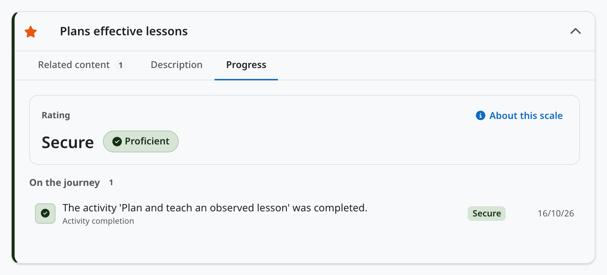

The plan can also be drawn as cards; a card opens its competency in a dialog with a pager across
the plan and a full-screen button.

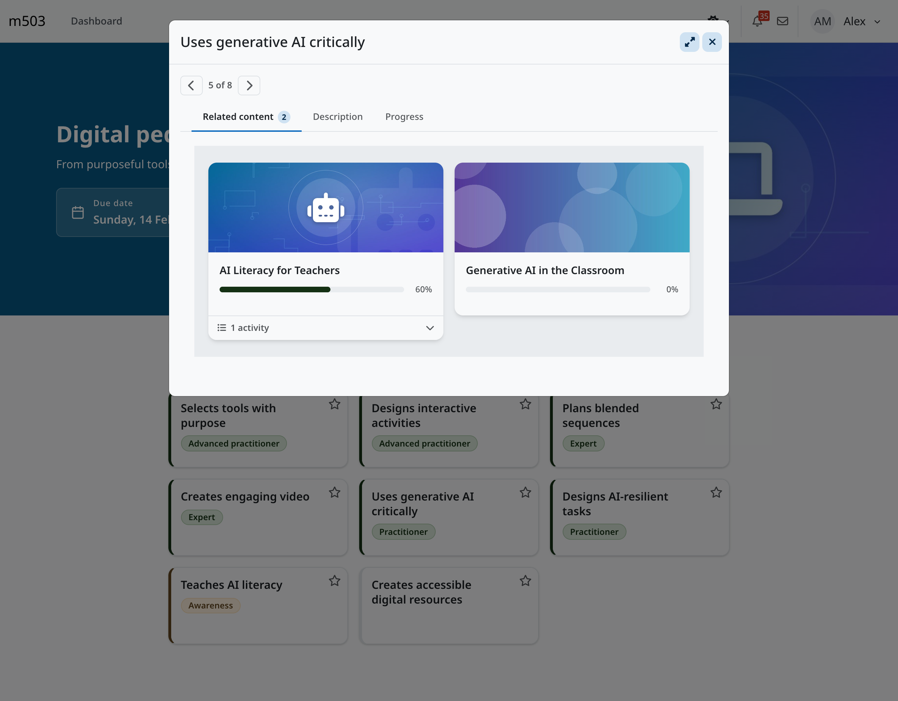

The hero folds: a handle on its bottom edge collapses it to a slim row, and that choice is stored
per plan and per competency and applied before the page paints. A draggable **Return to plan**
button brings learners back from a course to the plan they came from.

### The filter line

Both learner views share one line, in this order: the scope (*To do* and *All*, with counts), a
search, a favourites star, **Filters**, **Organise** (the sort) and the layout.

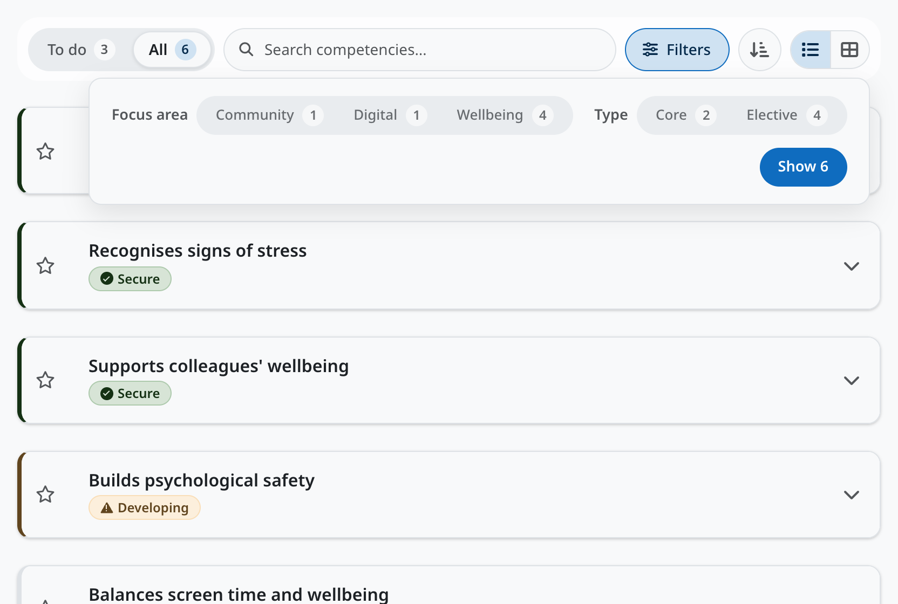

**Filters** opens a panel of the plan's tag fields, a count on every chip and *Show N* at its foot.
Each active filter becomes a chip under the line, with *Clear all* from two chips up, and the
button carries a count badge.

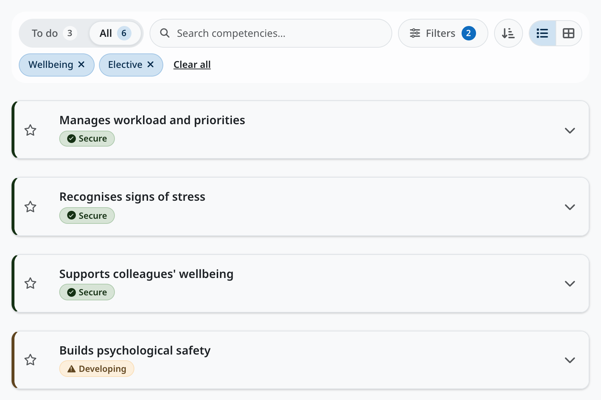

The line measures its own width and folds in four steps: Filters loses its word, the search becomes
an icon, then the line splits in two with the scope on the second line and the layout inside
Organise. From the third step the search grows over the line, with an eraser, a close button and
Escape; its suggestions offer the filters first (with the number each would leave, matched without
accents or case) and then the matching competencies, and `/` opens it. At the fourth step the
Filters panel is a bottom sheet.

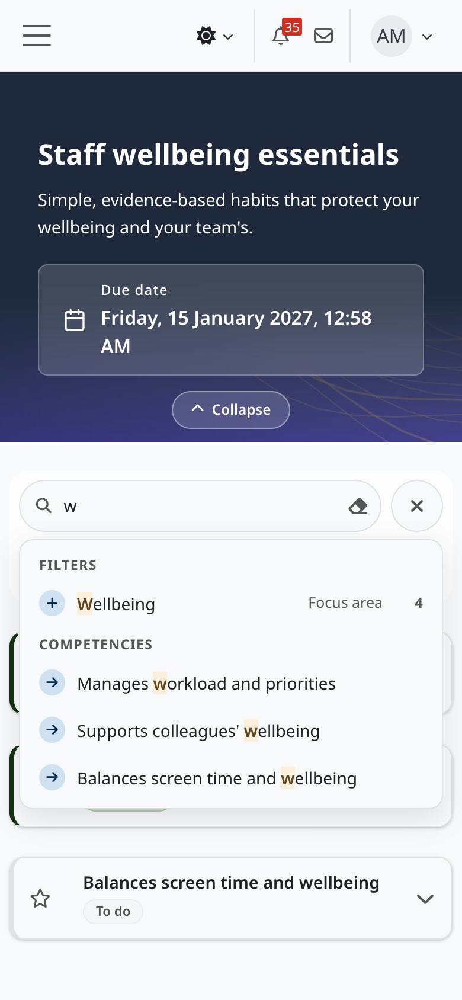
&nbsp;&nbsp;
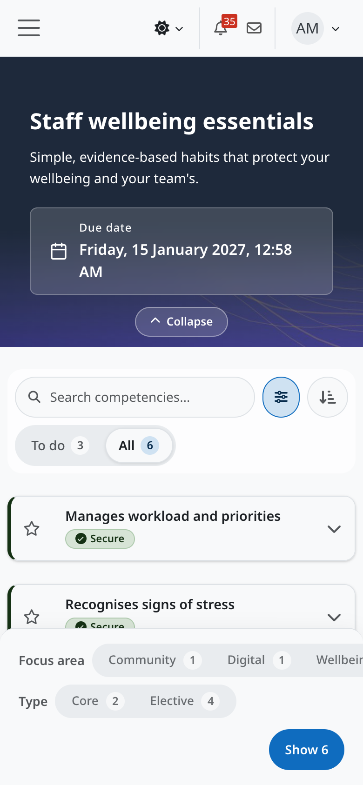

Each view remembers its own scope, sort and layout per user; the search text is never remembered.
With `enablefavourites` on (the default) learners star competencies and narrow the plan to them;
the star appears only on the learner's own plan, never to staff reviewing someone else's.

### Competency tracker

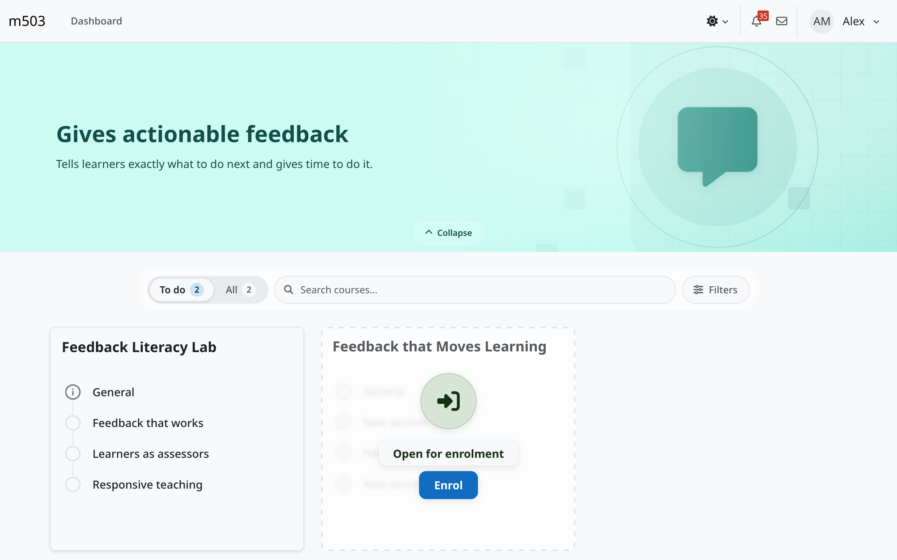

The courses of one competency as cards: real-time section progress (recursive subsections
included), a **Continue** shortcut to the first started but unfinished section, and a completion
seal on a finished course. A course that amounts to a single activity or section links straight to
it, and an optional redirect skips the grid when the learner has a single active enrolment.

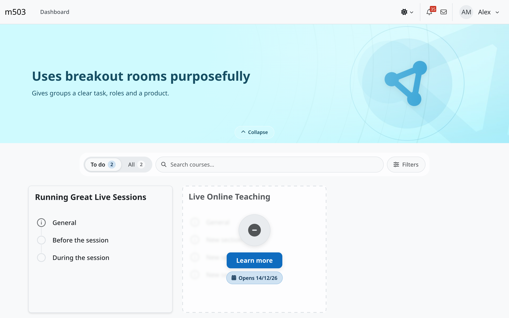

A course the learner cannot open yet keeps its frame (dashed border, blurred sections) and names
the learner's situation in one state: a way in where the course has one (self enrolment, or an
application where `enrol_apply` is installed), an application already lodged, an enrolment that
starts later, or the date the course opens. With *Use the enrolment rules of Unlisted courses* on,
where `local_unlistedcourses` is installed, the cards also show its states (waiting list, suspended
or ended enrolment, prerequisite course) with its rules; this plugin keeps no copy of them.

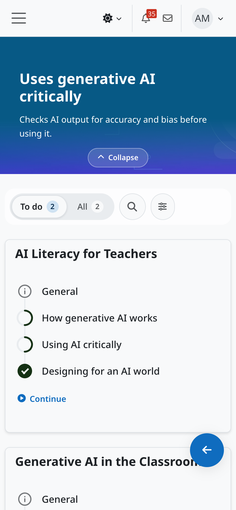

### Dark mode and the family theme

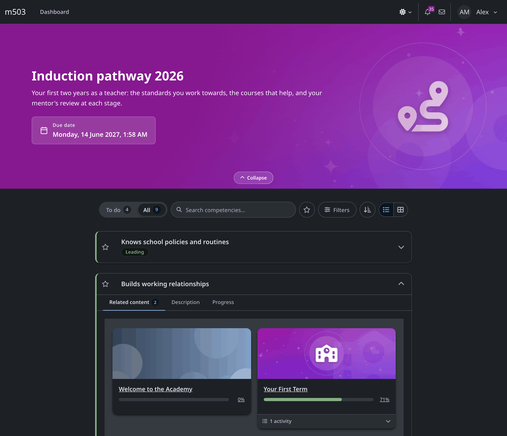

Every colour comes from the theme's tokens, so the views follow Moodle's dark mode, and a plan's
own colours stay where an administrator put them.

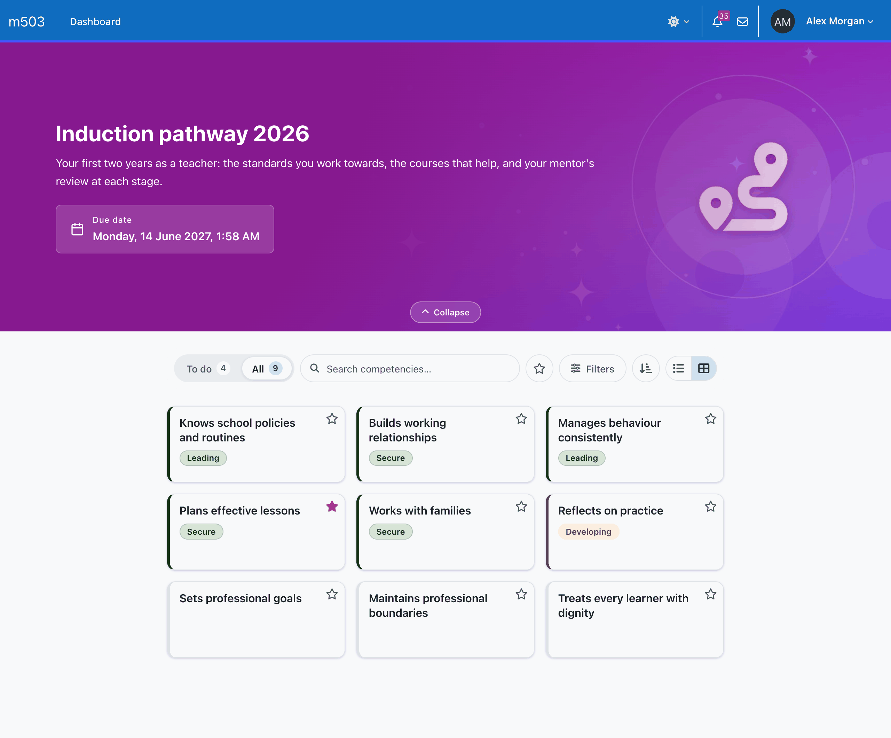

Under `theme_dimensions`, the family's theme, the plugin reads the theme's family tokens first;
without it nothing changes.

Requirements
------------

One branch per Moodle version, each declaring `$plugin->supported` for exactly that version:

| Branch | Moodle | Version | Release |
|---|---|---|---|
| `MOODLE_405_STABLE` | 4.5 LTS | 2024100702 | v4.5-r1 |
| `MOODLE_501_STABLE` | 5.1 | 2025100602 | v5.1-r1 |
| `MOODLE_502_STABLE` | 5.2 | 2026042002 | v5.2-r1 |
| `main` (= `MOODLE_503_STABLE`) | 5.3 | 2026100505 | v5.3-r1 |

The 4.5, 5.1 and 5.2 branches carry the same features; the 5.3 line (`main`) takes new work first
and uses PHP 8.3 syntax. This README and its pictures describe `main` on Moodle 5.3. Moodle 5.0 has
no branch.

- Core competencies enabled (`core_competency`).
- Optional, each reached only through a runtime guard, so the plugin installs and behaves the same
  without them:
  - `enrol_apply`: a locked course card recognises an application as a way in and shows one
    awaiting a decision as its own state.
  - `local_unlistedcourses` (Moodle 5.2 and later): the setting *Use the enrolment rules of
    Unlisted courses*, off by default.
  - `customfield_picture`: an alternative image handler for the card and background images.

Installation
------------

Install the plugin like any other plugin to folder `/local/dimensions`, from the branch for your
Moodle version. See [Installing plugins](https://docs.moodle.org/en/Installing_plugins).

**Switching a site from a date-numbered release** (any of them, no intermediate release needed):

1. Replace the plugin's files with the branch for the site's Moodle.
2. `php admin/cli/cfg.php --component=local_dimensions --name=version --set=2026100499`
   (the same for `block_dimensions` when it is installed, with its own branch).
3. `php admin/cli/upgrade.php`.

Step 2 comes after step 1; without it Moodle refuses the new files as a downgrade. The former
upgrade steps are applied as idempotent repairs on every upgrade.

Configuration
-------------

**Site administration > Competencies > Competency Dimensions settings** covers the *Return to plan*
button, image handling and custom SCSS, favourites (`enablefavourites`), and per-view display
options: the course section progress indicator, locked-card behaviour, the enrolment filter, the
single-course redirect, which sections each accordion panel shows (description, taxonomy, path,
related competencies, evidence, rules), and which custom fields the filter lines offer
(`viewplan_filter_fields` for the plan, `viewcompetency_filter_fields_course` for the tracker).

The same category holds the Competency hub and the two custom-field definition pages
(*competency* and *learning plan template* areas).

Accent-insensitive search
-------------------------

Competency, plan and course searches in the Competency hub are accent-insensitive ("lingua" also
matches "língua"). On MySQL/MariaDB this works out of the box via the database collation. On
**PostgreSQL** it uses the `unaccent` extension, which the plugin creates automatically
(`CREATE EXTENSION IF NOT EXISTS unaccent`) during upgrade or on first search where the database
user has permission; on supported PostgreSQL (13+) `unaccent` is a *trusted* extension the database
owner may create without superuser rights.

If your instance is locked down and the plugin cannot create it, run this once as a database
superuser and searches become accent-insensitive on PostgreSQL too (until then they degrade
gracefully to accent-sensitive):

    CREATE EXTENSION unaccent;

Capabilities
------------

- `local/dimensions:view`: see the learner views. Default: manager, teacher, authenticated user.
- `local/dimensions:editcustomscss`: edit the custom SCSS fields (risk: XSS, configuration). No role
  holds it by default.

The hub itself asks for core's own capabilities: `moodle/competency:competencymanage` and
`moodle/competency:templatemanage`, at the site or in the category.

Under the hood
--------------

- **No own tables**: everything lives in core competency tables, `customfield_data`, file areas,
  user preferences and MUC caches.
- **Performance**: metadata and progress caches with event-driven invalidation; lazy AJAX loading
  throughout; the read web services declare `readonlysession`, so on a site that enables read-only
  sessions they no longer wait for one another.
- **Background work**: plan generation from cohorts, cohort-role sync and bulk enrolment methods
  are queued as ad-hoc tasks with deduplication and Lock API serialisation, processed by Moodle's
  standard cron.
- **Frontend**: AMD modules, zero YUI, Mustache server-side rendering, namespaced CSS.

Accessibility
-------------

- Semantic HTML structure, ARIA labels and roles for screen readers (including `aria-labelledby`
  on tab panels).
- Full keyboard navigation for tabs following the WAI-ARIA Tabs pattern (arrow keys, Home/End,
  roving `tabindex`); the filter line's scope is a radio group with arrow keys.
- SVG progress circles with `aria-label` for completion percentages; screen reader labels for
  proficiency status icons.
- Status icons take their colours from the theme and follow dark mode and Windows high-contrast
  mode; the colour fields check WCAG contrast as they are edited.

Theme support
-------------

This plugin is developed and tested on Moodle core's Boost theme and should work with Boost child
themes. Boost Union and its children get a stylesheet of their own, which keeps the learner views'
hero against the navigation bar when a smart menu exists. Under `theme_dimensions` the plugin reads
the family tokens first. We can't support any other theme.

Privacy
-------

The plugin stores no personal data beyond five per-user preferences: two that remember the
Competency hub's last-visited view and display choices, and three that remember the learner views'
choices, favourite competencies and folded headers. They are exported by the Privacy API on a
data-subject request and removed on plugin uninstall. Custom field data belongs to competencies and
learning plan templates, not to users. Course progress is calculated in real time, and temporary
session cache entries are used only for navigation and rendering during active sessions.

The plugin implements the Moodle Privacy API as a preference-only provider
(`core_privacy\local\request\user_preference_provider`).

Scheduled tasks
---------------

This plugin adds no scheduled (cron-registered) tasks. It queues **ad-hoc background tasks** on
demand (plan generation from template cohorts, cohort-role synchronisation and bulk enrolment
methods), which Moodle's standard cron processes.

Demo data
---------

The pictures above come from a demo site built by the scripts in
[`docs/screenshots/tools/`](docs/screenshots/tools/README.md): eighteen frameworks, twenty-one plan
templates with generated imagery, cohorts, cohort roles, course and activity links, ratings and
evidence, and a learner who holds plans in every status. Development sites only.

Companion plugin
----------------

**Dimensions Block** (`block_dimensions`) shows the learner's plans and competencies as cards on the
Dashboard or on a page of its own, styled with the custom fields managed here.

Repository: https://github.com/uaiblaine/moodle-block_dimensions

Plugin repositories
-------------------

This plugin is not yet published in the Moodle plugins repository.

The latest development version can be found on GitHub:
https://github.com/uaiblaine/moodle-local_dimensions

Bug and problem reports / Support requests
------------------------------------------

This plugin is carefully developed and thoroughly tested, but bugs and problems can always appear.

Please report bugs and problems on GitHub:
https://github.com/uaiblaine/moodle-local_dimensions/issues

We will do our best to solve your problems, but please note that due to limited resources we can't
always provide per-case support.

Feature proposals
-----------------

Please issue feature proposals on GitHub:
https://github.com/uaiblaine/moodle-local_dimensions/issues

Please create pull requests on GitHub:
https://github.com/uaiblaine/moodle-local_dimensions/pulls

Translating this plugin
-----------------------

This Moodle plugin is shipped with English and Brazilian Portuguese language packs. All
translations into other languages must be managed through AMOS (https://lang.moodle.org) by what
they will become part of Moodle's official language pack.

Right-to-left support
---------------------

This plugin has not been tested with Moodle's support for right-to-left (RTL) languages.
If you want to use this plugin with an RTL language, and it doesn't work as-is, you are free to
send us a pull request on GitHub with modifications.

Contributors
------------

- Anderson Blaine
- William Mano

Copyright
---------

The copyright of this plugin is held by\
Anderson Blaine

Individual copyrights of individual developers are tracked in PHPDoc comments and Git commits.
